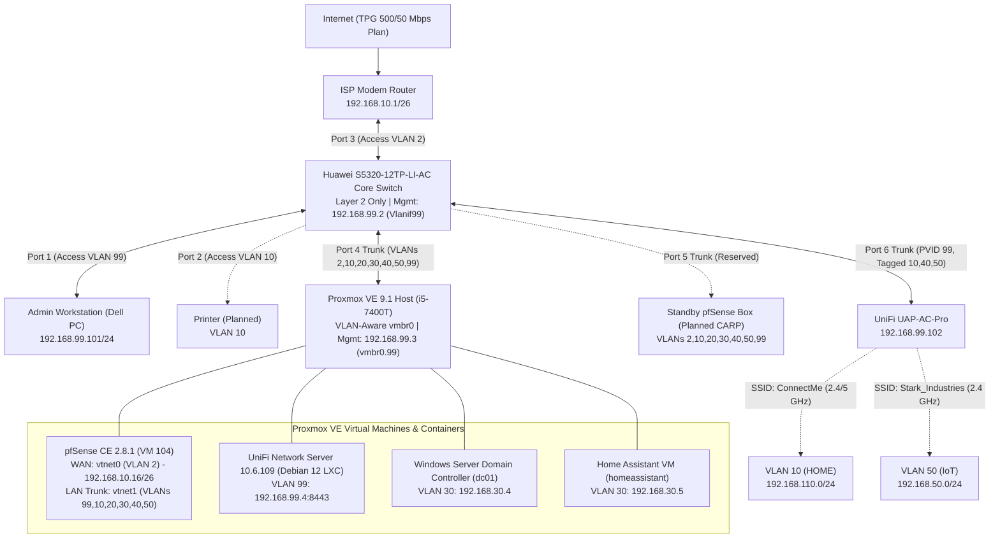

# Segmented Home Lab Network & AI-Assisted pfSense VirtIO Recovery

**Project Type:** Network Engineering · Cybersecurity Segmentation · Proxmox Virtualisation · Infrastructure Automation  
**Environment:** Huawei S5320-12TP-LI-AC · Proxmox VE 9.1 · pfSense CE 2.8.1 · UniFi UAP-AC-Pro · Windows Server AD (`dc01`) · Home Assistant  
**Status:** Production Active — All 6 VLANs Operational · **538.08 Mbps Download / 53.94 Mbps Upload (`20%` Peak CPU)**

---

## 1. Executive Summary

This repository documents the end-to-end engineering journey of rebuilding a flat consumer home network (`192.168.10.0/26`) into a **6-VLAN segmented enterprise-style network** with **pfSense CE 2.8.1** on **Proxmox VE** as the sole router and stateful firewall, backed by a **Huawei S5320-12TP-LI-AC** Layer 2 core switch and VLAN-tagged **UniFi** wireless SSIDs.

It is written as an **honest engineering build log and case study**: what was planned, what actually happened on the wire, how a **92 Mbps throughput bottleneck** on a **500 Mbps** internet connection was diagnosed and solved by migrating from emulated **Intel E1000 (`em0`/`em1`)** NICs to paravirtualized **VirtIO (`vtnet0`/`vtnet1`)** NICs, and how an **autonomous AI-assisted recovery workflow** over SSH used pfSense's native PHP configuration subsystem to recover wiped VLAN interface assignments, catch hidden firewall policy bugs, and restore full line-rate performance (**538.08 Mbps download / 53.94 Mbps upload at 20% CPU**).

Rather than hiding mistakes, every human and AI assistant error encountered along the way is logged alongside the fix and engineering takeaway.

---

## 2. Architecture & Topology



### Logical & Physical Topology



---

## 3. Hardware, Software & Addressing Plan

### Infrastructure Specifications

| Component | Details & Configuration |
|---|---|
| **Core Switch** | **Huawei S5320-12TP-LI-AC** — Layer 2 only; 8x GbE copper (`1`–`8`), 2x combo (`9`–`10`), 2x SFP-only (`11`–`12`). Hardened with SSH-only (`stelnet`), `Vlanif99` (`192.168.99.2`), and inbound ACL `2099`. Unused ports `7`–`12` shut down. |
| **Hypervisor** | **Proxmox VE 9.1.x** — Intel Core i5-7400T (4C/4T @ 2.40 GHz), 15.5 GiB RAM, single physical NIC (`nic0`) bound to VLAN-aware `vmbr0`; host management on `vmbr0.99` (`192.168.99.3/24`). |
| **Firewall / Router** | **pfSense CE 2.8.1 (VM 104)** — Q35 machine, 4 vCPUs (`host`), 4 GiB RAM, 32 GB VirtIO-SCSI disk, 2x **VirtIO (`vtnet0` WAN, `vtnet1` LAN trunk)** adapters. |
| **Wireless** | **UniFi UAP-AC-Pro** (`192.168.99.102`, PoE injector on Port 6) managed by **UniFi Network Server 10.6.109** in a Debian 12 LXC (`192.168.99.4`) running MongoDB 7.0 and Eclipse Temurin Java 25. |
| **Core Services** | **Windows Server Active Directory (`dc01`)** at `192.168.30.4` · **Home Assistant VM (`homeassistant`)** at `192.168.30.5` · **Remote Syslog Collector** at `192.168.20.9:5514`. |

### VLAN & Subnet Architecture

| VLAN | pfSense ID | Name | Subnet | pfSense Gateway | DHCP Pool | Key Hosts & Purpose |
|---:|---|---|---|---|---|---|
| **2** | `wan` (`vtnet0`) | `WAN` | `192.168.10.0/26` | `192.168.10.1` *(Modem)* | ISP Modem DHCP | pfSense WAN (`192.168.10.16/26`); isolated transit to ISP modem on Huawei Port 3 |
| **10** | `opt1` (`vtnet1.10`) | `HOME` | `192.168.110.0/24` | `192.168.110.1` | `.110.100` – `.110.199` | Personal devices, `ConnectMe` Wi-Fi SSID, Printer (Port 2) |
| **20** | `opt2` (`vtnet1.20`) | `LAB` | `192.168.20.0/24` | `192.168.20.1` | `.20.100` – `.20.199` | Lab VMs, security testing, remote syslog server (`192.168.20.9:5514`) |
| **30** | `opt3` (`vtnet1.30`) | `SERVERS` | `192.168.30.0/24` | `192.168.30.1` | `.30.100` – `.30.149` | `dc01` (`192.168.30.4` static) & `homeassistant` (`192.168.30.5` static) |
| **40** | `opt4` (`vtnet1.40`) | `GUEST` | `192.168.40.0/24` | `192.168.40.1` | `.40.100` – `.40.200` | Untrusted guest Wi-Fi (internet-only) |
| **50** | `opt5` (`vtnet1.50`) | `IoT` | `192.168.50.0/24` | `192.168.50.1` | `.50.100` – `.50.200` | Smart home devices (`Stark_Industries` 2.4 GHz SSID, Tuya, TP-Link, ESPHome) |
| **99** | `lan` (`vtnet1.99`) | `MGMT` | `192.168.99.0/24` | `192.168.99.1` | `.99.100` – `.99.199` | pfSense (`.99.1`), Huawei Switch (`.99.2`), Proxmox (`.99.3`), UniFi LXC (`.99.4`), Admin PC (`.99.101`), AP (`.99.102`) |

### Huawei S5320 Port Map

| Port | Media Type | Connected Device | Mode & VLAN Configuration |
|---|---|---|---|
| `GigabitEthernet0/0/1` | RJ45 Copper | Admin Dell PC (`192.168.99.101`) | `access` — `VLAN 99`, `stp edged-port enable` |
| `GigabitEthernet0/0/2` | RJ45 Copper | Printer *(Planned)* | `access` — `VLAN 10`, `stp edged-port enable` |
| `GigabitEthernet0/0/3` | RJ45 Copper | ISP Modem LAN Port (`192.168.10.1`) | `access` — `VLAN 2 (WAN)` |
| `GigabitEthernet0/0/4` | RJ45 Copper | Proxmox VE Host (`nic0` / `vmbr0`) | `trunk` — `allow-pass vlan 2 10 20 30 40 50 99` |
| `GigabitEthernet0/0/5` | RJ45 Copper | Standby pfSense *(Reserved for CARP)* | `trunk` — `allow-pass vlan 2 10 20 30 40 50 99` |
| `GigabitEthernet0/0/6` | RJ45 Copper | UniFi UAP-AC-Pro *(via PoE Injector)* | `trunk` — `pvid vlan 99`, `allow-pass vlan 10 40 50 99`, `undo allow-pass vlan 1` |
| `GigabitEthernet0/0/7`–`12` | Copper / SFP | Unused | `shutdown` *(ports `9`–`10` are combo; `11`–`12` are SFP-only `COMMON FIBER`)* |

---

## 4. Security & Firewall Policy Matrix

Every non-management VLAN (`opt1`–`opt5`) enforces a strict top-down rule evaluation order in pfSense:
1. **Allow DNS (TCP/UDP `53`)** and **DHCP (UDP `67`)** to the local VLAN gateway IP (`optXip`).
2. **Block All Access to `This Firewall (self)`:** Prevents non-management VLANs from reaching the pfSense WebGUI (`:443`), SSH (`:22`), or other gateway IPs.
3. **Explicit Least-Privilege Inter-VLAN Pinholes:**
   - `HOME (VLAN 10)` $\rightarrow$ `Home Assistant (192.168.30.5)`
   - `IoT (VLAN 50)` $\rightarrow$ `Home Assistant (192.168.30.5)`
   - `Home Assistant (192.168.30.5)` $\rightarrow$ `IoT Subnet (192.168.50.0/24)`
   - `LAB (VLAN 20)` $\rightarrow$ `SERVERS Subnet (192.168.30.0/24)`
4. **Block All Other Internal & Modem Networks (`<*_BLOCKED_NETWORKS>`):** Blocks RFC1918 cross-VLAN traffic **and** blocks access to the upstream ISP modem subnet (`192.168.10.0/26`).
5. **Allow Internet (`any`):** Permits outbound internet traffic via automatic NAT on `vtnet0`.

| Source $\downarrow$ / Destination $\rightarrow$ | `MGMT (99)` | `HOME (10)` | `LAB (20)` | `SERVERS (30)` | `GUEST (40)` | `IoT (50)` | `pfSense (self)` | `Modem (10.0/26)` | `Internet` |
|---|---|---|---|---|---|---|---|---|---|
| **`MGMT (VLAN 99)`** | Allow | Allow | Allow | Allow | Allow | Allow | **Allow (Admin)** | Allow | Allow |
| **`HOME (VLAN 10)`** | Block | Own VLAN | Block | **Allow `.30.5` (HA) only** | Block | Block | **Allow `:53`/`:67` only** | Block | Allow |
| **`LAB (VLAN 20)`** | Block | Block | Own VLAN | **Allow (Stateful)** | Block | Block | **Allow `:53`/`:67` only** | Block | Allow |
| **`SERVERS (VLAN 30)`** | Block | Block | Block new | Own VLAN | Block | **Allow `.30.5` $\rightarrow$ `IoT` only** | **Allow `:53`/`:67` only** | Block | Allow |
| **`GUEST (VLAN 40)`** | Block | Block | Block | Block | Own VLAN | Block | **Allow `:53`/`:67` only** | Block | Allow |
| **`IoT (VLAN 50)`** | Block | Block | Block | **Allow `.30.5` (HA) only** | Block | Own VLAN | **Allow `:53`/`:67` only** | Block | Allow |

---

## 5. The 500 Mbps Bottleneck, VirtIO Migration & Autonomous AI Recovery

### A. Diagnosing the 92 Mbps Cap
1. **Baseline:** Paid for a **500/50 Mbps** plan; direct Wi-Fi on the ISP modem measured **539 Mbps**.
2. **Initial pfSense State (1 vCPU, 2 GB RAM, Intel E1000):** Wired and wireless clients behind pfSense were stuck at **~92 Mbps** with 100% CPU utilization.
3. **Resource Upgrade (4 vCPUs, 4 GB RAM, Intel E1000):** Throughput rose to **143 Mbps download / 52 Mbps upload** with pfSense CPU peaking at **57%**—proving that QEMU **Intel E1000 (`em0`/`em1`)** NIC emulation overhead and single-queue interrupt serialization were bottlenecking packet forwarding.

### B. What Happened During the VirtIO Migration
1. Created Proxmox snapshot `Before_VirtIO_Migration` and switched `net0` and `net1` from `Intel E1000` to `VirtIO (paravirtualized)`.
2. Upon reboot, FreeBSD renamed the adapters from `em0`/`em1` to `vtnet0`/`vtnet1`, stranding the existing `em1.*` VLAN definitions and forcing the pfSense console `1) Assign Interfaces` wizard.
3. **The Console Assignment Pitfall:** After creating `vtnet1.99`–`vtnet1.50` and assigning `WAN -> vtnet0` and `LAN -> vtnet1.99`, pressing **Enter** at `Enter the Optional 1 interface name ... or nothing if finished` caused pfSense (`revision 1794936514`) to **delete `<opt1>` through `<opt5>` from `<interfaces>`**.
4. Re-adding `OPT1`–`OPT5` in the WebGUI created blank, disabled interfaces on `vtnet1.10`–`vtnet1.50` with no IPv4 addresses or descriptions—even though `<dhcpd>`, `<filter>`, `<aliases>`, and `<unbound>` were still intact in `/cf/conf/config.xml`!

### C. Autonomous SSH + PHP Recovery & Hidden Security Bugs Fixed
Using SSH (`root@192.168.99.1`), `/cf/conf/backup/config-1794935923.xml` was diffed against the live `/cf/conf/config.xml` and recovered programmatically using pfSense's native PHP subsystem (`config.inc`, `interfaces.inc`, `services.inc`, `filter.inc`):
- **Live Interface & Service Restoration ([`scripts/recover_step1_interfaces.php`](./scripts/recover_step1_interfaces.php)):** Restored `OPT1`–`OPT5` IPv4 gateways, subnets, descriptions, and `vtnet1` VLAN descriptions, and reloaded `opt1`–`opt5`, `isc-dhcpd`, `unbound`, and `pf` with zero management downtime.
- **Security Bugs Caught by Automated XML Audit ([`scripts/recover_step2_firewall_audit_fix.php`](./scripts/recover_step2_firewall_audit_fix.php)):**
  1. **Critical IoT Firewall Bug:** Rule `1794928789` (`IOT - Block other internal networks` on `opt5`) had `<type>pass</type>` instead of `<type>block</type>`, permitting IoT devices into all internal subnets! Fixed to `<type>block</type>`.
  2. **Missing IoT Subnet in Block Aliases:** Added `192.168.50.0/24` (`IoT`) to `INTERNAL_NETWORKS`, `LAB_BLOCKED_NETWORKS`, `SERVERS_BLOCKED_NETWORKS`, and `GUEST_BLOCKED_NETWORKS`.
- **Obsolete `em1` Cleanup ([`scripts/cleanup_phase_c_obsolete_vlans.php`](./scripts/cleanup_phase_c_obsolete_vlans.php)):** Removed the 6 obsolete `em1.*` VLAN entries from `<vlans>` and destroyed the orphaned kernel VLAN interfaces.

### D. Throughput Benchmark Results (Ookla Speedtest CLI + `vmstat`)

| Stage | NIC Model | vCPU / RAM | Download Speed | Upload Speed | Packet Loss | pfSense Peak CPU |
|---|---|---|---|---:|---:|---:|
| **ISP Modem Wi-Fi** *(Reference)* | N/A | N/A | 539.00 Mbps | ~50.00 Mbps | 0.0% | N/A |
| **Stage 1 — Initial VM** | Intel E1000 (`em`) | 1 vCPU / 2 GB | 91.62 Mbps | ~45.00 Mbps | — | 100% |
| **Stage 2 — CPU/RAM Upgrade** | Intel E1000 (`em`) | 4 vCPU / 4 GB | 143.00 Mbps | 52.00 Mbps | — | 57% |
| **Stage 3 — VirtIO Migration** | **VirtIO (`vtnet`)** | **4 vCPU / 4 GB** | **538.08 Mbps** | **53.94 Mbps** | **0.0%** | **20%** *(80% idle)* |

- **Official Ookla Speedtest Verification:** https://www.speedtest.net/result/c/35308725-f831-4f1a-a8be-147c626867a7

---

## 6. Repository Navigation

```text
Segmented-HomeLab-pfSense-VirtIO-Recovery/
├── README.md                                       # Master project overview & case study
├── docs/
│   ├── 01-foundation-build-log.md                  # Phase 1–10 build log: Flat LAN -> Huawei S5320, Proxmox, Cutover, UniFi LXC, CARP
│   ├── 02-virtio-migration-and-recovery.md         # Deep-dive E1000->VirtIO migration, console pitfall, SSH/PHP recovery & benchmarks
│   ├── 03-mistakes-and-lessons-learned.md          # Complete engineering log of 23 human & AI mistakes and corrective lessons
│   └── 04-troubleshooting-and-validation.md        # 10-point validation matrix, change log (CHG-001..017) & CLI cheat sheet
├── configs/
│   ├── pfsense-config-sanitized.xml                # Recovered pfSense 2.8.1 VirtIO config.xml (sensitive keys/hashes redacted)
│   ├── huawei-s5320-switch.cfg                     # Huawei S5320-12TP-LI-AC Layer 2 VLAN, trunk & SSH/ACL 2099 config
│   ├── proxmox-network-and-vm104.conf              # Proxmox /etc/network/interfaces (vmbr0/vmbr0.99) & VM 104 VirtIO config
│   └── unifi-lxc-install.sh                        # Reproducible Debian 12 LXC installer for UniFi 10.6.109 (MongoDB 7 + Temurin Java 25)
├── scripts/
│   ├── pfsense_xml_auditor.py                      # Standalone Python 3 pfSense config.xml dependency & security auditor
│   ├── recover_step1_interfaces.php                # Live pfSense PHP script to restore OPT1-OPT5 IPv4/descriptions & services
│   ├── recover_step2_firewall_audit_fix.php        # Live pfSense PHP script to fix IoT pass->block rule & block aliases
│   ├── cleanup_phase_c_obsolete_vlans.php          # Live pfSense PHP script to remove obsolete em1 VLANs & kernel interfaces
│   └── speedtest_multistream.py                    # Multi-stream Python HTTPS download/upload throughput benchmark
├── diagrams/
│   └── home_network_current_and_planned.svg        # Architecture diagram (active vs. planned links, ports, VLANs)
└── screenshots/
    └── README.md                                   # 8 annotated screenshots from Proxmox, pfSense, UniFi, Home Assistant & PowerShell
```

---

## 7. Top 10 Engineering Lessons Learned

1. **Always use VirtIO (`vtnet`) for high-throughput Proxmox firewalls:** Emulated Intel E1000 (`em`) NICs capped a 4-vCPU VM at `143 Mbps @ 57% CPU`; switching to VirtIO immediately delivered **`538.08 Mbps @ 20% CPU`**.
2. **Beware the pfSense Console `Assign Interfaces` OPT wipe:** Pressing Enter at `Optional 1` during console interface reassignment deletes `<opt1>`–`<optN>` from `<interfaces>`, even though `<dhcpd>`, `<filter>`, `<aliases>`, and `<unbound>` remain intact in `config.xml`.
3. **Audit compiled `pfctl -sr` rules, not just GUI descriptions:** A rule named `IOT - Block other internal networks` had accidentally been saved with `<type>pass</type>`. Automated XML auditing ([`pfsense_xml_auditor.py`](./scripts/pfsense_xml_auditor.py)) caught it immediately.
4. **Update existing VLAN block aliases whenever adding a new VLAN:** Adding `VLAN 50 (IoT)` required appending `192.168.50.0/24` to the block aliases of `HOME`, `LAB`, `SERVERS`, and `GUEST`.
5. **Use pfSense's native PHP API (`/etc/inc/config.inc`) for surgical live recovery:** Calling `interface_configure('opt1'..'opt5')` restored all 5 VLANs live over SSH without resetting `lan` (`vtnet1.99`) or risking a full XML overwrite.
6. **Check live subnet addressing before finalizing a VLAN plan:** Discovering the ISP modem used `192.168.10.0/26` before cutover allowed cleanly renumbering `VLAN 10 (HOME)` to `192.168.110.0/24`.
7. **Know your switch's physical port types:** On the Huawei S5320-12TP-LI-AC, ports `9`–`10` are combo ports while `11`–`12` are SFP-only (`COMMON FIBER`).
8. **Never run `pfctl -d` to test firewall rules:** Disabling `pf` also disables outbound NAT, breaking internet connectivity across all VLANs. Use `pfctl -sr`, firewall logs, and targeted client checks.
9. **Official vendor docs go stale—verify package metadata directly:** Installing UniFi Network Server `10.6.109` on Debian 12 required bypassing Ubiquiti's `0-byte` APT repo index and installing `mongodb-org-server` 7.0 + Eclipse Temurin Java 25 (`temurin-25-jre`).
10. **Plan for CARP before hardcoding static infrastructure:** Putting the ISP modem into an untagged `VLAN 2` access port on the switch allows both the primary Proxmox pfSense VM and a future physical standby box to share the WAN segment cleanly.

---

## 8. Roadmap & Next Steps

- [ ] **Remove Proxmox Snapshot (`Before_VirtIO_Migration`):** Delete the migration snapshot on VM 104 after a 48-hour burn-in period so the `qcow2` delta does not grow.
- [ ] **Active Directory DNS Integration:** Update the `LAB (VLAN 20)` DHCP scope to hand out `192.168.30.4` (`dc01`) as primary DNS, with `dc01` forwarding external queries to pfSense (`192.168.30.1`).
- [ ] **Guest Wi-Fi SSID (`VLAN 40`):** Broadcast the Guest SSID on the UniFi AP with L2 client isolation enabled.
- [ ] **NTP for Huawei Switch:** Point the Huawei S5320 at pfSense (`192.168.99.1`) so its clock persists across power cycles.
- [ ] **Standby pfSense Hardware Appliance (CARP):** Deploy the secondary x86 box on **Huawei Port 5** with `.253`/`.254` real interface IPs and `.1` shared CARP VIPs across all VLANs.
- [ ] **ISC DHCP $\rightarrow$ Kea Migration:** Transition pfSense DHCP backend from ISC DHCPd to Kea once all static reservations and CARP settings are finalized.
