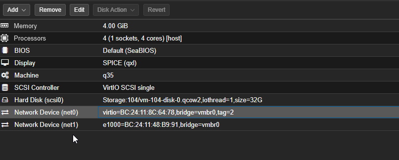
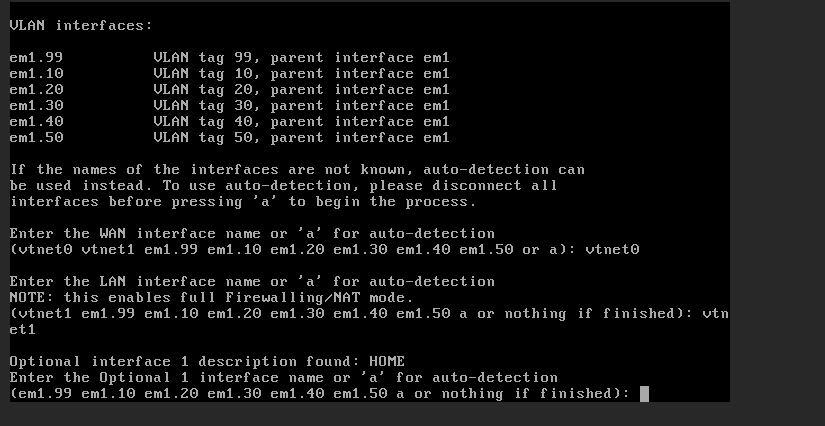
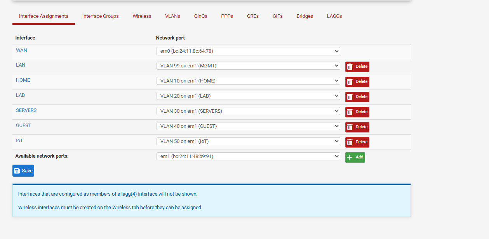
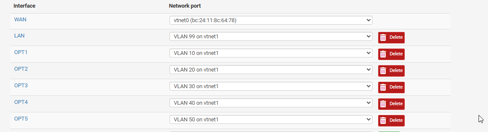
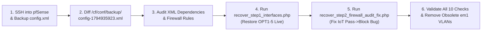

# Part 2: The 500 Mbps Bottleneck, VirtIO Migration & Autonomous AI Recovery

Once the 6-VLAN segmented network was operational, performance testing revealed a major throughput bottleneck that led to the **Intel E1000 $\rightarrow$ VirtIO migration** and an **autonomous AI-assisted recovery**.

---

## 1. Investigating the 92 Mbps Throughput Bottleneck

### Initial Symptom
Despite paying for a **500/50 Mbps** internet plan (and measuring **539 Mbps** directly on the ISP modem's built-in Wi-Fi), clients behind pfSense—both wired on the Huawei switch and wireless on UniFi—were capped at **~91.6–93 Mbps**.

### Systematic Elimination
1. **Physical Layer Check:** Verified all active Huawei S5320 switch ports (`1, 3, 4, 6`) and the Proxmox physical NIC were negotiating at **1000 Mbps Full Duplex** (`1 Gbps`), ruling out a 100 Mbps Fast Ethernet link or bad cable.
2. **Traffic Shaper / Limiter Check:** Verified no pfSense limiters (`<dnshaper>`) or UniFi Wi-Fi speed profiles were active.
3. **VM Resource Upgrade (1 vCPU / 2 GB $\rightarrow$ 4 vCPU / 4 GB):**
   - Initially, pfSense VM 104 had only `1 vCPU` and `2 GB RAM`, and CPU usage hit 100% during speed tests.
   - Upgrading VM 104 to **4 vCPUs (`host` CPU type) and 4 GB RAM** improved throughput from **92 Mbps to 143 Mbps download / 52 Mbps upload**, with pfSense CPU peaking at **57%**.
4. **Root Cause Identified — QEMU Intel E1000 Emulation Overhead:**
   - Even with 43% idle CPU headroom across 4 cores, single-queue emulated **Intel E1000 (`em0`/`em1`)** network adapters in QEMU/KVM suffer from high per-packet MMIO exit overhead and single-vCPU interrupt serialization on the Intel Core i5-7400T host.
   - Reaching full 500+ Mbps line rate required migrating both VM NICs (`net0` and `net1`) to paravirtualized **VirtIO (`vtnet0`/`vtnet1`)**.

---

## 2. The E1000-to-VirtIO Migration & Console Assignment Pitfall

### Pre-Migration Preparation
1. Created a Proxmox VM snapshot named **`Before_VirtIO_Migration`** (`TASK OK`).
2. Switched VM 104 `net0` (`BC:24:11:8C:64:78`, `vmbr0`, `tag=2`) and `net1` (`BC:24:11:48:B9:91`, `vmbr0`, untagged trunk) from `Intel E1000` to `VirtIO (paravirtualized)`.

### What Went Wrong During Interface Reassignment
When pfSense booted with VirtIO adapters, the underlying FreeBSD driver names changed from `em0`/`em1` to `vtnet0`/`vtnet1`. Because existing VLANs (`em1.99`, `em1.10`, `em1.20`, `em1.30`, `em1.40`, `em1.50`) still referenced `em1`, pfSense dropped into the console `1) Assign Interfaces` prompt:

1. New VLANs (`99, 10, 20, 30, 40, 50`) were created on `vtnet1`, `WAN` was assigned to `vtnet0`, and `LAN` was assigned to `vtnet1.99`.
2. **The Pitfall:** At the prompt `Enter the Optional 1 interface name ... or nothing if finished`, pressing **Enter** caused pfSense (`revision 1794936514`) to **delete `<opt1>` through `<opt5>` from the `<interfaces>` section of `/cf/conf/config.xml`**.
3. When `OPT1`–`OPT5` were subsequently re-added via the WebGUI (`Interfaces -> Interface Assignments`), pfSense created blank `<opt1>`–`<opt5>` blocks on `vtnet1.10`–`vtnet1.50`—disabled, with no IPv4 gateway addresses, and generic `OPT1`–`OPT5` names:

| Pre-Migration (`em1` VLANs) | Post-Console Assignment (`vtnet1` VLANs) |
|---|---|
|  |  |

---

## 3. Autonomous AI Discovery & Live Recovery via SSH + PHP API

Rather than manually retyping every subnet, description, DHCP scope, and firewall rule—or blindly overwriting the live configuration with an older backup—an autonomous recovery workflow was executed over SSH (`root@192.168.99.1`):

### Discovery Findings
By diffing `/cf/conf/backup/config-1794935923.xml` (captured immediately before the console wipe) against the live `/cf/conf/config.xml`:
- **Preserved Config Sections:** Even though `<opt1>`–`<opt5>` had been wiped from `<interfaces>`, **100% of `<dhcpd>`, `<filter>`, `<aliases>`, and `<unbound>` remained intact** in `config.xml` and still referenced logical names `opt1`–`opt5`.
- **Two Critical Security Bugs Discovered During Audit:**
  1. **IoT Block Rule Set to `PASS`:** Rule tracker `1794928789` (`IOT - Block other internal networks` on `opt5`, destination `IoT_BLOCKED_NETWORKS`) had `<type>pass</type>` instead of `<type>block</type>`!
  2. **VLAN 50 (`192.168.50.0/24`) Missing from Other Block Aliases:** `INTERNAL_NETWORKS` (HOME), `LAB_BLOCKED_NETWORKS` (LAB), `SERVERS_BLOCKED_NETWORKS` (SERVERS), and `GUEST_BLOCKED_NETWORKS` (GUEST) had not been updated to include `192.168.50.0/24` when VLAN 50 was added.

### Automated Execution (Zero Management Downtime)
1. **Step 1 ([`scripts/recover_step1_interfaces.php`](../scripts/recover_step1_interfaces.php)):**
   - Programmatically restored `HOME` (`192.168.110.1/24`), `LAB` (`192.168.20.1/24`), `SERVERS` (`192.168.30.1/24`), `GUEST` (`192.168.40.1/24`), and `IoT` (`192.168.50.1/24`) onto `vtnet1.10`–`vtnet1.50`, restored VLAN descriptions (`MGMT`, `HOME`, `LAB`, `SERVERS`, `GUEST`, `IoT`), and called `interface_configure('opt1'..'opt5')`, `services_dhcpd_configure()`, `services_unbound_configure()`, and `filter_configure()` without resetting `lan` (`vtnet1.99`).
2. **Step 2 ([`scripts/recover_step2_firewall_audit_fix.php`](../scripts/recover_step2_firewall_audit_fix.php)):**
   - Changed rule `1794928789` (`IOT - Block other internal networks`) to `<type>block</type>` and added `192.168.50.0/24` to the 4 inter-VLAN block aliases.
3. **Step 3 ([`scripts/cleanup_phase_c_obsolete_vlans.php`](../scripts/cleanup_phase_c_obsolete_vlans.php)):**
   - Confirmed zero remaining references to `em0`/`em1` in `config.xml`, removed the 6 obsolete `em1.*` VLAN definitions, and destroyed the orphaned kernel VLAN interfaces (`ifconfig em1.X destroy`).

---

## 4. Before vs. After Performance Benchmark

Tested from the Dell Admin Workstation (`192.168.99.101` $\rightarrow$ Huawei Switch Port 1 $\rightarrow$ Port 4 Trunk $\rightarrow$ Proxmox `vmbr0` $\rightarrow$ pfSense `vtnet1.99` $\rightarrow$ `vtnet0` $\rightarrow$ ISP Modem `192.168.10.1`) using the official **Ookla Speedtest CLI** (`Server: Launtel - Sydney, id: 61743`) while capturing 1-second `vmstat` CPU telemetry on pfSense:

| Metric | Intel E1000 (1 vCPU / 2 GB) | Intel E1000 (4 vCPU / 4 GB) | **VirtIO (`vtnet0` + `vtnet1`, 4 vCPU / 4 GB)** | Improvement (E1000 $\rightarrow$ VirtIO) |
|---|---:|---:|---:|---:|
| **Download Speed** | 91.62 Mbps | 143.00 Mbps | **538.08 Mbps** | **+276% (3.76x faster)** |
| **Upload Speed** | ~45.00 Mbps | 52.00 Mbps | **53.94 Mbps** | **100%+ of 50 Mbps plan** |
| **Packet Loss** | — | — | **0.0%** | **Zero loss** |
| **pfSense Peak CPU** | 100% | 57% | **20% (`80% idle`)** | **-65% lower CPU load** |

- **Official Speedtest Verification URL:** https://www.speedtest.net/result/c/35308725-f831-4f1a-a8be-147c626867a7
